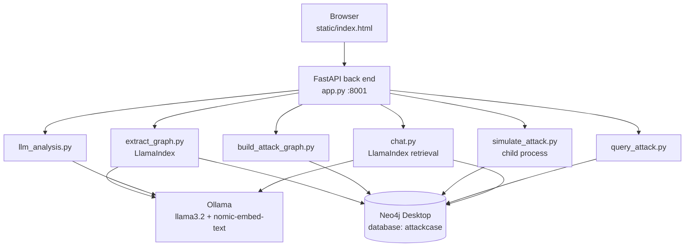

# LLM + Neo4j Attack Case Pipeline

A fully local pipeline that uses a large language model to build, explore and analyze a cyber attack stored as a Neo4j knowledge graph. A synthetic intrusion modelled on FIN7 (MITRE ATT&CK group G0046) moves from a workstation to an application server and on to a customer database. The pipeline extracts a knowledge graph from incident reports, simulates live security events, reconstructs the attack timeline and path, and answers analyst questions, all without sending data to a cloud service.

> **Research context.** This repository is part of PhD research comparing LLM-only, RAG and GraphRAG approaches to attack reconstruction. The scenario is synthetic and does not describe a real incident or real FIN7 activity.

## Contents

- [Features](#features)
- [Architecture](#architecture)
- [Repository structure](#repository-structure)
- [Prerequisites](#prerequisites)
- [Setup, step by step](#setup-step-by-step)
- [Running the pipeline](#running-the-pipeline)
- [Using the web interface](#using-the-web-interface)
- [Running modules from the command line](#running-modules-from-the-command-line)
- [Configuration reference](#configuration-reference)
- [Graph data model](#graph-data-model)
- [API reference](#api-reference)
- [Troubleshooting](#troubleshooting)
- [Security](#security)
- [Release process](#release-process)
- [Known limitations](#known-limitations)
- [Acknowledgements](#acknowledgements)

## Features

- **Local LLM:** Llama 3.2 and the nomic-embed-text embedding model, served by Ollama.
- **Knowledge-graph extraction:** LlamaIndex turns `.txt` / `.md` incident reports into a graph that follows a MITRE ATT&CK schema (threat actors, techniques, tactics, hosts, databases, data assets, events).
- **Attack simulation:** a hand-built environment (WS01, AppServer, CustomerDB, CustomerData) plus a simulator that writes a new attack event every five seconds.
- **Attack reconstruction:** a chronological timeline, the lateral-movement path and the sensitive assets, queried from Neo4j.
- **LLM security analysis:** a ten-part report generated from the graph evidence.
- **Graph question answering:** answers grounded in the extracted graph and the attack timeline.
- **Web interface:** one page to configure and test the Neo4j connection, run every step, and explore an interactive graph with zoom controls.

## Architecture



| Layer | Technology | Role |
| --- | --- | --- |
| LLM | Ollama, `llama3.2` | Entity extraction, security analysis, chat answers |
| Embeddings | Ollama, `nomic-embed-text` | Vectors for entities and text chunks |
| Framework | LlamaIndex | Chunking, schema-guided extraction, graph retrieval |
| Database | Neo4j Desktop 5.23+ with APOC | Stores the simulation graph and the extracted graph |
| Back end | Python 3.12, FastAPI, Uvicorn | REST API, background jobs |
| Front end | HTML, CSS, JavaScript, vis-network | Single-page interface and graph view |

## Repository structure

```
llm-neo4j-attack-case/
├── app.py                    FastAPI back end (entry point)
├── static/index.html         Web interface
├── .env_pipeline.example     Configuration template (copy to .env_pipeline)
├── requirements.txt          Pinned Python dependencies
├── CHANGELOG.md              Release history
├── data/
│   └── fin7_attack_case_report.txt   Sample incident report
└── src/
    ├── config.py             Loads the configuration file
    ├── neo4j_connection.py   Neo4j driver and runtime connection settings
    ├── extract_graph.py      LlamaIndex knowledge-graph extraction
    ├── chat.py               Graph question answering
    ├── build_attack_graph.py Hand-built environment and baseline events
    ├── simulate_attack.py    Live attack event simulator
    ├── query_attack.py       Timeline, attack path, sensitive assets
    └── llm_analysis.py       Structured LLM security analysis
```

`app_streamlit.py` is the earlier Streamlit prototype (Neo4j Aura, configured through `.env`). It is kept for reference and is not part of this pipeline.

## Prerequisites

| Software | Version | Check |
| --- | --- | --- |
| [Neo4j Desktop](https://neo4j.com/download/) | DBMS 5.23 or later, APOC plugin | DBMS shows **Running** |
| [Ollama](https://ollama.com/download) | Current release | `ollama --version` |
| [Python](https://www.python.org/downloads/) | 3.12 (3.13 should work; 3.14 is not supported by all dependencies) | `py -0` (Windows) or `python3 --version` |
| Git | Any recent version | `git --version` |
| Hardware | 16 GB RAM recommended; a GPU speeds up Ollama but is optional | |
| Internet | Needed once for installs and for the graph-view library (unpkg.com) | |

## Setup, step by step

Commands are shown for **Windows PowerShell**. macOS / Linux equivalents follow where they differ.

### 1. Clone the repository

```powershell
git clone https://github.com/<your-account>/llm-neo4j-attack-case.git
cd llm-neo4j-attack-case
```

### 2. Prepare Neo4j Desktop

1. Install and open Neo4j Desktop.
2. Create a local DBMS (version 5.23 or later) and set its password.
3. Open the DBMS **Plugins** tab and install **APOC**.
4. Start the DBMS.
5. Open **Neo4j Browser** on the DBMS and create the project database:

   ```cypher
   :use system
   CREATE DATABASE attackcase;
   ```

   If your edition cannot create extra databases, use the default `neo4j` database instead and set `NEO4J_DATABASE=neo4j` in step 5.

### 3. Install the Ollama models

```powershell
ollama pull llama3.2
ollama pull nomic-embed-text
ollama list
```

Both models should appear in the list. Ollama serves them at `http://localhost:11434`.

### 4. Create the Python environment

```powershell
py -3.12 -m venv venv
venv\Scripts\Activate.ps1
python --version          # should print 3.12.x
pip install -r requirements.txt
```

macOS / Linux:

```bash
python3.12 -m venv venv
source venv/bin/activate
pip install -r requirements.txt
```

If PowerShell refuses to run `Activate.ps1`, run once: `Set-ExecutionPolicy -Scope CurrentUser RemoteSigned`.

### 5. Create the configuration file

```powershell
copy .env_pipeline.example .env_pipeline
```

(macOS / Linux: `cp .env_pipeline.example .env_pipeline`)

Open `.env_pipeline` and check the values (see [Configuration reference](#configuration-reference)). Leave `NEO4J_PASSWORD` empty to type it in the web page; fill it only if you will run modules from the command line. `.env_pipeline` is git-ignored and must never be committed.

## Running the pipeline

1. Make sure the Neo4j DBMS is **Running** and Ollama is running.
2. Start the app from the project folder, with the virtual environment active:

   ```powershell
   python app.py
   ```

3. Open **http://127.0.0.1:8001** in a browser.

Stop the app with `Ctrl+C`. Restart it after changing `.env_pipeline` or any code.

## Using the web interface

Work through the sections from top to bottom. The status bar at the top shows the Neo4j connection, Ollama, the simulation and node counts.

| Section | What to do | Expected result |
| --- | --- | --- |
| 1. Neo4j connection | Check URI, username and database; enter the password; click **Test connection**, then **Connect**. Click **Check Ollama**. | "Connected to Neo4j …"; Ollama reports both models installed |
| 2. Extract a knowledge graph | Select `fin7_attack_case_report.txt` (or upload a `.txt` / `.md`), keep **Restrict to the attack schema** ticked, click **Extract graph**. | After several minutes: "extraction completed" with entity, relationship and chunk counts |
| 3. Attack environment and simulation | Click **Build attack environment**, then **Start simulation**. | Environment created; a new event every five seconds |
| 4. Attack timeline | Watch the table, or click **Refresh timeline**. | Events in time order with technique, tactic and host |
| 5. Graph view | Choose a scope (everything, extracted, simulation) and click **Load graph**. Use **+**, **−** and **Fit** to zoom. | Interactive, colour-coded graph; hover a node for its properties |
| 6. LLM security analysis | Click **Run analysis**. | A ten-part report after a minute or more |
| 7. Ask the graph | Type a question and click **Ask**. | An answer plus how much graph and timeline evidence was used |

Sample questions:

- Which techniques did FIN7 use on WS01?
- How did the attacker move from WS01 to CustomerDB?
- Which tactic does T1555 belong to?
- What sensitive data was at risk?

**Clear extracted graph** (section 2) removes only extracted data; **Build attack environment** rebuilds only the simulation graph.

## Running modules from the command line

Each module can run on its own. Put the password in `.env_pipeline` first, then:

```powershell
$env:ATTACK_CASE_ENV_FILE = ".env_pipeline"
python src/neo4j_connection.py                     # test the connection
python src/extract_graph.py                        # extract data/fin7_attack_case_report.txt
python src/build_attack_graph.py                   # build the simulation graph
python src/simulate_attack.py                      # run the live simulator
python src/query_attack.py                         # print timeline, assets, paths
python src/llm_analysis.py                         # LLM security analysis
python src/chat.py "Which techniques did FIN7 use?"
```

macOS / Linux: `export ATTACK_CASE_ENV_FILE=.env_pipeline`.

## Configuration reference

All settings live in `.env_pipeline`. Connection values entered in the web page override the file for as long as the app runs and are never written to disk.

| Variable | Default | Purpose |
| --- | --- | --- |
| `NEO4J_URI` | `neo4j://127.0.0.1:7687` | Neo4j Desktop address |
| `NEO4J_USERNAME` | `neo4j` | Database user |
| `NEO4J_PASSWORD` | *(empty)* | Typed in the page, or set here for command-line use |
| `NEO4J_DATABASE` | `attackcase` | Database used by the pipeline |
| `OLLAMA_BASE_URL` | `http://localhost:11434` | Ollama server |
| `OLLAMA_LLM_MODEL` | `llama3.2` | Generation model (any Ollama chat model can be swapped in) |
| `OLLAMA_EMBED_MODEL` | `nomic-embed-text` | Embedding model |
| `OLLAMA_REQUEST_TIMEOUT` | `600` | Seconds to wait for the model |

## Graph data model

One database holds two graphs. Different label spellings keep them separate, so rebuilding one never deletes the other.

| Graph | Created by | Node labels | Relationships |
| --- | --- | --- | --- |
| Simulation | `build_attack_graph.py`, `simulate_attack.py` | `Host`, `Database`, `DataAsset`, `ThreatActor`, `Technique`, `Tactic`, `Event` | `CAN_REACH`, `CONTAINS`, `USES`, `PART_OF`, `ASSOCIATED_WITH`, `INDICATES`, `OCCURRED_ON`, `FOLLOWED_BY` |
| Extracted | LlamaIndex (`extract_graph.py`) | `THREAT_ACTOR`, `TECHNIQUE`, `TACTIC`, `HOST`, `DATABASE`, `DATA_ASSET`, `EVENT`, plus `Chunk`; all carry `__Node__`, entities also `__Entity__` | `USES`, `TARGETS`, `PART_OF`, `USED_ON`, `INDICATES`, `OCCURRED_ON`, `FOLLOWED_BY`, `CAN_REACH`, `CONTAINS`, `MENTIONS` |

Useful Cypher in Neo4j Browser:

```cypher
// Attack timeline
MATCH (e:Event)-[:INDICATES]->(t:Technique), (e)-[:OCCURRED_ON]->(h)
RETURN e.timestamp, t.id, t.name, h.name ORDER BY e.timestamp;

// Extracted entities by type
MATCH (n:__Entity__) RETURN labels(n), count(*) ORDER BY count(*) DESC;
```

## API reference

The interface is built on this REST API (all JSON). Interactive documentation is available at **http://127.0.0.1:8001/docs** while the app runs.

| Method | Path | Purpose |
| --- | --- | --- |
| GET | `/` | Web interface |
| GET | `/api/config` | Defaults from `.env_pipeline` (password never returned) |
| GET | `/api/status` | Connection, simulation, extraction job, counts |
| POST | `/api/connection/test` | Test credentials, database and APOC |
| POST | `/api/connection/connect` | Test, then use the connection |
| POST | `/api/connection/disconnect` | Stop using the connection |
| GET | `/api/ollama/check` | Ollama reachable, models installed |
| GET | `/api/documents` | List documents in `data/` |
| POST | `/api/documents/upload` | Upload a `.txt` / `.md` file (max 2 MB) |
| POST | `/api/extract` | Start extraction in the background |
| GET | `/api/extract/status` | Extraction progress and result |
| POST | `/api/extract/clear` | Delete the extracted graph |
| POST | `/api/attack/build` | Build the simulation graph |
| POST | `/api/simulation/start` | Start the live simulator |
| POST | `/api/simulation/stop` | Stop the simulator |
| GET | `/api/timeline` | Attack timeline |
| GET | `/api/graph?scope=all\|extracted\|simulation` | Nodes and relationships for the graph view |
| POST | `/api/analysis` | LLM security analysis |
| POST | `/api/chat` | Question answering |

## Troubleshooting

| Symptom | Likely cause | Fix |
| --- | --- | --- |
| "Could not reach Neo4j" | DBMS not started or wrong URI | Start the DBMS; use `neo4j://127.0.0.1:7687` |
| "Database 'attackcase' does not exist" | Database not created | Run `CREATE DATABASE attackcase` against `system`, or use `neo4j` |
| "APOC was not found" | Plugin missing | Install APOC for the DBMS and restart it |
| Ollama check fails | Ollama stopped or model missing | Start Ollama; run the `ollama pull` commands |
| `pip install` fails on a package version | Python 3.14 or newer | Recreate the venv with Python 3.12 |
| Extraction ends with 0 entities | Small model returned output outside the schema | Untick strict schema and retry, or try a larger model |
| "Build the attack environment first" | Simulation started too early | Build the environment, then start the simulation |
| Graph library could not be loaded | No access to unpkg.com | Connect to the internet and reload; other sections still work |
| Settings or code changes ignored | App still running the old version | Stop with `Ctrl+C` and run `python app.py` again |

## Security

- The app listens on `127.0.0.1` only and has no authentication. Do not expose port 8001 to a network.
- Secrets live in `.env_pipeline` and `.env`, both git-ignored. Only `.env_pipeline.example` (no password) is committed.
- Passwords typed in the page are held in memory only and never returned by the API.
- All model calls go to the local Ollama server; no data leaves the machine except the graph-view library download.
- Before every commit, check that `git status` lists no `.env` files. If a secret is ever committed, change that password immediately; removing the file from a later commit does not remove it from history.

## Release process

### Versioning

The project uses [Semantic Versioning](https://semver.org/): `MAJOR.MINOR.PATCH`.

- **MAJOR:** breaking changes (configuration, graph schema or API that existing users must adapt to).
- **MINOR:** new features that keep compatibility.
- **PATCH:** bug fixes only.

Every change is recorded under `[Unreleased]` in `CHANGELOG.md`; the section is renamed to the version number at release time.

### Branching

- `main` is always releasable. Protect it in GitHub (**Settings → Branches**): require a pull request and at least one review before merging.
- Work happens on short-lived branches: `feature/<name>`, `fix/<name>`, `docs/<name>`.
- Merge to `main` through a pull request that describes the change and how it was tested.

### Release checklist

1. All changes for the release are merged into `main`.
2. Dependencies: `requirements.txt` stays pinned; any version change is tested and noted in the changelog.
3. Secrets: `git status` and the diff contain no `.env`, passwords or keys.
4. Smoke test on a clean environment (new venv, empty `attackcase` database):
   - `pip install -r requirements.txt` succeeds.
   - Section 1: connection test and Ollama check pass.
   - Section 2: extraction of the sample report completes with more than 0 entities.
   - Sections 3–7: build, simulate, timeline, graph view, analysis and chat all work.
5. Update `CHANGELOG.md`: rename `[Unreleased]` to the new version and date.
6. Commit, tag and push:

   ```powershell
   git commit -am "Release v0.2.0"
   git tag -a v0.2.0 -m "v0.2.0: Phase 2 local pipeline"
   git push origin main --tags
   ```

7. On GitHub, open **Releases → Draft a new release**, choose the tag, and paste the changelog section as the release notes.

### First push to GitHub

```powershell
git init
git add .
git status          # confirm .env, .env_pipeline and venv/ are NOT listed
git commit -m "Initial commit: Phase 2 local pipeline (v0.2.0)"
git branch -M main
git remote add origin https://github.com/<your-account>/llm-neo4j-attack-case.git
git push -u origin main
```

Create the empty repository on GitHub first (without a README, so the histories do not conflict). For unpublished dissertation work, consider making the repository **private** until your supervisor agrees to publish.

## Known limitations

- Llama 3.2 is a small model: extraction is slower and less precise than with large hosted models, and results can vary between runs.
- The scenario is synthetic: eight baseline events and an eight-step simulation.
- Connection settings entered in the page last only while the app runs.
- Only `.txt` and `.md` documents can be uploaded.
- The graph view loads its library from the internet.

## Acknowledgements

- [MITRE ATT&CK®](https://attack.mitre.org/) is a registered trademark of The MITRE Corporation. Technique and group identifiers are used for research under MITRE's terms of use.
- Built with [Neo4j](https://neo4j.com/), [Ollama](https://ollama.com/), [LlamaIndex](https://www.llamaindex.ai/), [FastAPI](https://fastapi.tiangolo.com/) and [vis-network](https://visjs.github.io/vis-network/docs/network/).

## License

No license has been chosen yet. Until one is added, all rights are reserved by the author. Check your university's policy on research code before choosing one (for example MIT or Apache-2.0).

## Author

Okikiola Akindipe
